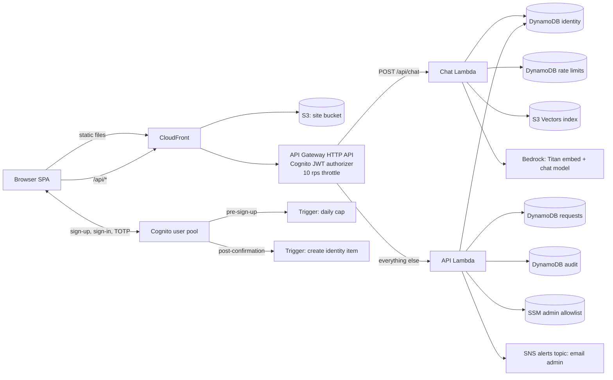
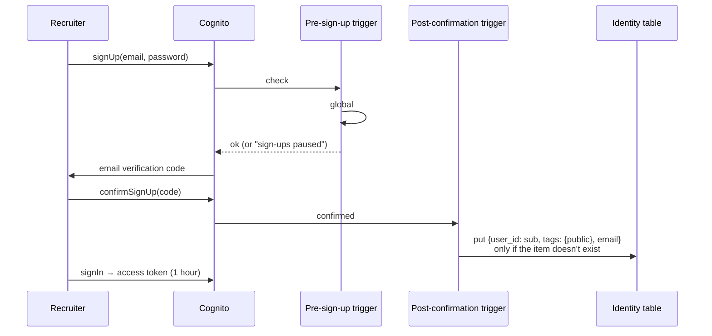
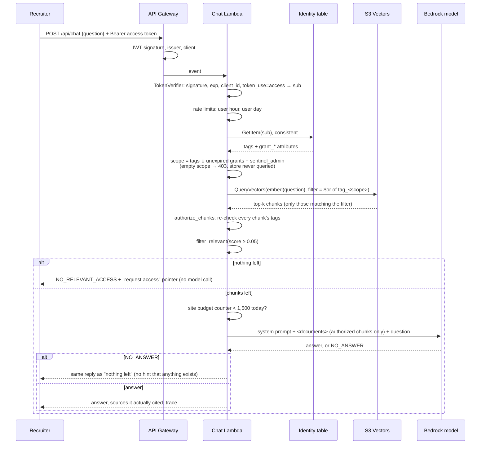
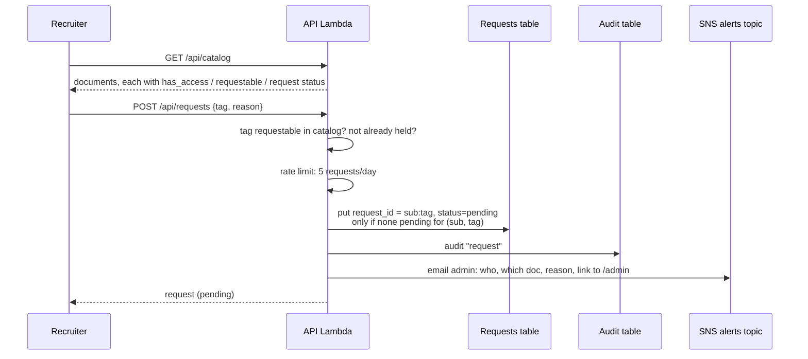
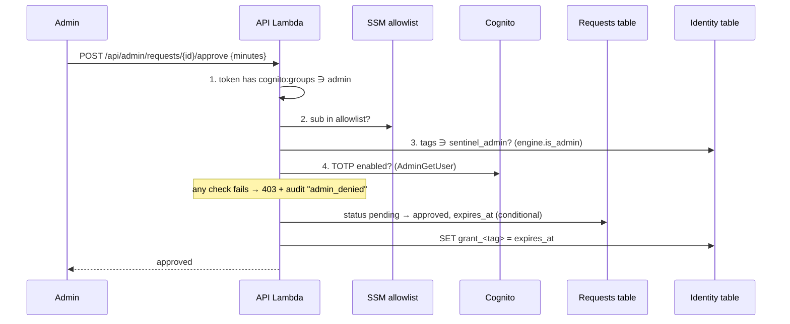
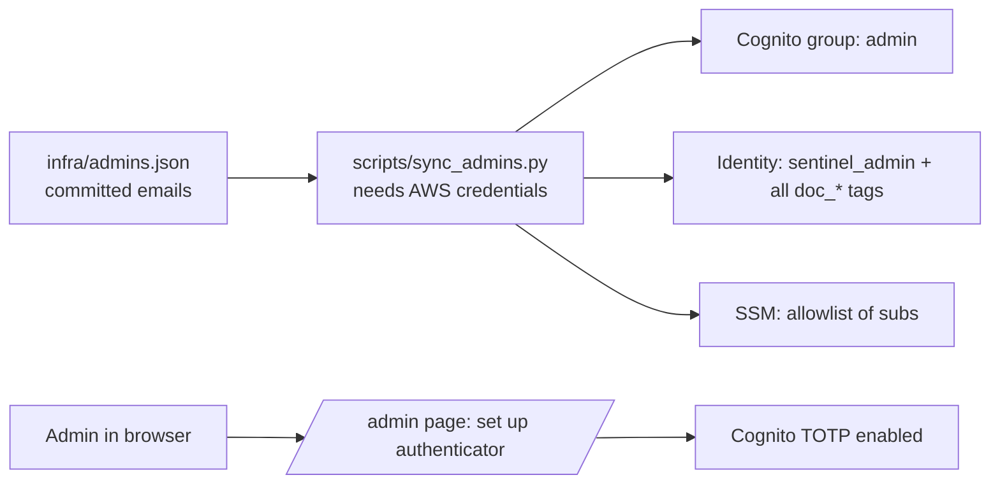
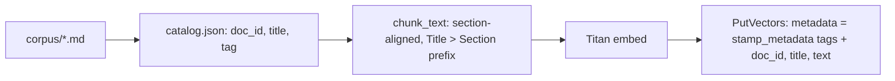

# Flows

How each request moves through the system. Diagrams are Mermaid and render on GitHub. The reasoning
behind each choice is in [DECISIONS.md](DECISIONS.md).

## Components

## 1. Sign-up

The trigger never overwrites an existing item, so re-confirming can't reset an admin's tags.

## 2. Chat: the Sentinel path

The `trace` returned to the page holds the scope, the exact filter, how many chunks were retrieved,
how many the re-check removed, how many were below the relevance cutoff, and the titles sent to the
model. The "Why can't I see that?" panel renders it.

## 3. Request access

## 4. Approve, deny, revoke

- **Deny** flips the status to `denied`. The recruiter may file again later.
- **Revoke** runs `REMOVE grant_<tag>` and takes effect on the recruiter's next question.
- **Expiry** needs no action: `get_tags` ignores a grant whose expiry has passed.

## 5. Becoming an admin

All four outputs are needed. Removing an email and re-running the script removes the group, the tags
and the allowlist entry.

## 6. Ingest (operator)

`stamp_metadata` (sentinel-engine) writes `tag_<t>: true` and `access_tags`, and rejects reserved
tags and caller-supplied `tag_*` keys. Re-ingesting a document deletes its old chunk keys first.

## Failure behavior

| Failure | Result |
|---|---|
| Missing, expired, forged or ID token | 401 |
| Identity item missing or no tags | 403, vector store never queried |
| DynamoDB or SSM error on an admin check | that check fails → 403 |
| Vector store ignores the filter | post-check removes the extra chunks |
| Over a per-user limit | 429 with `Retry-After` |
| Site model budget spent | 503 "resting" until the next UTC day |
| Audit write fails | logged to CloudWatch; the request still completes |
